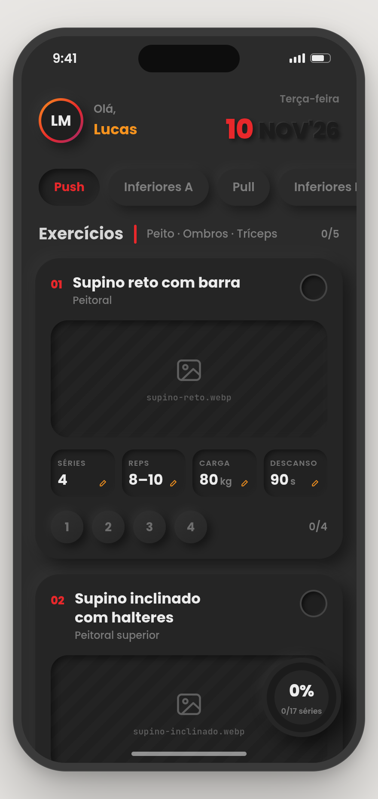
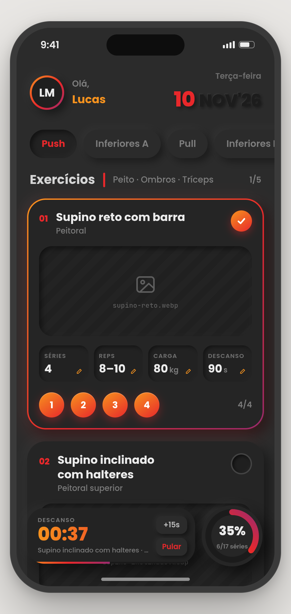
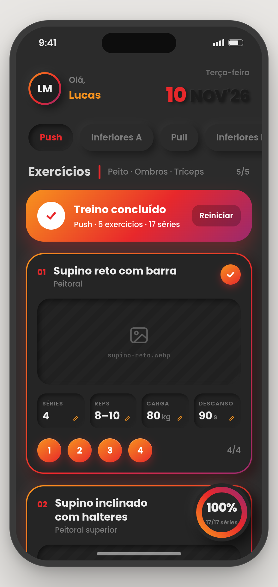

# gym-fire

App mobile de **ficha de treino**: uma tela única para executar o treino do dia — marcar séries,
acompanhar o progresso e controlar o descanso entre séries.

Estética **neumórfica escura** com acentos em degradê laranja → vermelho → magenta.
Alvo: 390 × 844 pt (iPhone 14/15), tema escuro fixo, pt-BR.

|  |  |  |
|:--:|:--:|:--:|
| Início do treino | Descanso ativo | Treino concluído |

---

## Estado atual

> 🟡 **Início da implementação.** O projeto Expo está criado e o tema já sai de `tokens.json`.
> A tela ainda é uma prova de fumaça do tema; os componentes vêm a seguir.

| Área | Situação |
|---|---|
| Design (tokens, componentes, 9 telas, HTML de referência) | ✅ completo |
| Especificação funcional (`promp-app.md`) | ✅ validada em 10/11/2026 |
| Scaffold Expo (SDK 58) + `src/theme.ts` | ✅ 11/11/2026 |
| Componentes e tela | ⬜ não iniciados |
| Assets `.webp` dos exercícios | 🟡 8 de 31 (Pull completo, 1 do Upper), recodificados (1,9 MB) |

---

## O que o app faz

- **5 sessões** em abas: Push, Inferiores A, Pull, Inferiores B, Upper.
  A aba inicial segue o dia da semana; o progresso de cada sessão é preservado ao alternar.
- **Card por exercício** com mídia animada (`.webp`), séries, repetições, carga e descanso.
- **Esferas de série** — tocar marca a série e dispara o descanso daquele exercício.
- **Anel de progresso flutuante** — séries feitas ÷ séries totais da sessão.
- **Painel de descanso** — contagem por timestamp, `+15s`, `Pular`, pulso nos últimos 5 s,
  e um aviso no topo quando zera.
- **Edição inline** — tocar em qualquer dado abre uma folha com steppers
  (séries, reps, carga de 2,5 em 2,5 kg, descanso de 15 em 15 s).
- **Treino concluído** — banner no topo da lista com resumo e botão "Reiniciar".
- Progresso e edições **persistidos localmente**.

---

## Stack

Expo SDK 58 (React Native 0.88) + TypeScript, rodando no Expo Go. Sem backend e sem login.
Node LTS instalado via nvm.

`expo-image` (WebP animado) · `react-native-svg` · `expo-linear-gradient` · `@react-native-masked-view/masked-view` ·
`expo-haptics` · `@expo/vector-icons` · `react-native-safe-area-context` ·
`@react-native-async-storage/async-storage` · `expo-font` + Poppins e JetBrains Mono

Sem bibliotecas de UI prontas — todos os componentes são próprios, para manter a fidelidade
ao design neumórfico.

---

## Como rodar

```bash
npm install
npx expo start      # abra no Expo Go pelo QR code
npx tsc --noEmit    # checagem de tipos
```

Para ver as animações originais, abra no navegador:
`design/reference/Ficha de Treino - Referência.dc.html`

---

## Estrutura do repositório

```
CLAUDE.md                 regras do projeto para o Claude Code
promp-app.md              especificação funcional: comportamento, dados, ficha, aceite
README.md                 este arquivo

design/                   pacote de handoff (fonte da verdade visual)
  tokens.json             cores, sombras, raios, espaços, tipografia, motion
  DESIGN.md               conceito, layout, movimento, regras
  COMPONENTS.md           anatomia e estados de cada componente
  screens/                01–06 estados da tela · 07–09 fundamentos, componentes, animações
  blocks/                 recortes por componente e por animação
  reference/              HTML executável com os valores originais

assets/exercises/<sessao>/<slug>.webp    mídias dos exercícios (recodificadas)
scripts/recode-media.py                  recodifica um .webp original para o card

index.ts                  ponto de entrada do Expo → src/App.tsx
src/
  App.tsx                 por ora, prova de fumaça do tema
  theme.ts                importa design/tokens.json e converte para RN
  data/ficha.ts           (a criar)
  hooks/                  useWorkout · useRestTimer · useReducedMotion
  components/             Header, WorkoutTabs, ExerciseCard, ProgressRing, RestPanel, …
```

---

## Fontes da verdade

Nesta ordem: `design/tokens.json` → `design/COMPONENTS.md` → `design/DESIGN.md` →
`design/screens/*.png` → `design/reference/*.dc.html` → `promp-app.md`.

Conflito **visual** → vence o design. Conflito de **comportamento ou de dados** → vence
`promp-app.md`. Nenhum valor de cor, sombra, raio ou fonte é digitado à mão: tudo sai de
`tokens.json`.

As regras completas de implementação estão em [`CLAUDE.md`](CLAUDE.md).

---

## Roadmap

1. ~~Scaffold do Expo + `src/theme.ts` gerado de `tokens.json`.~~ ✅
2. Componentes isolados, comparados com `design/screens/08-componentes.png`.
3. Montagem da tela e validação dos estados `01`–`06`.
4. Movimento conforme `DESIGN.md §7`, incluindo reduced-motion.
5. Persistência local e `EditSheet`.
6. *(depois)* Histórico de cargas por semana, como nas colunas Sem. 1–4 da ficha.

---

## Pendências conhecidas

- Faltam 23 dos 31 arquivos `.webp` que a ficha pede — Push (6), Inferiores A (6),
  Inferiores B (6) e Upper (5). Exercícios sem mídia mostram o placeholder: é o estado de
  design previsto, não um bug.
- Os PNGs usam uma ficha de mock (5 exercícios, 17 séries, descanso de 90 s) diferente da
  ficha real em `promp-app.md §9`. Os PNGs valem como referência **visual**, não de conteúdo.
- Nome e iniciais do usuário ficam constantes (**Thiago / TH**) — não há tela de perfil.
  "Lucas" / "LM" nos PNGs é nome de mock.
- A ficha original registra cargas por semana (4 semanas por bloco). O app guarda só o valor
  atual; o histórico semanal é a próxima feature.

---

## Fora do escopo

Outras telas, navegação, histórico de cargas por semana, login, sincronização, notificações
em segundo plano, cadastro ou reordenação de exercícios.
